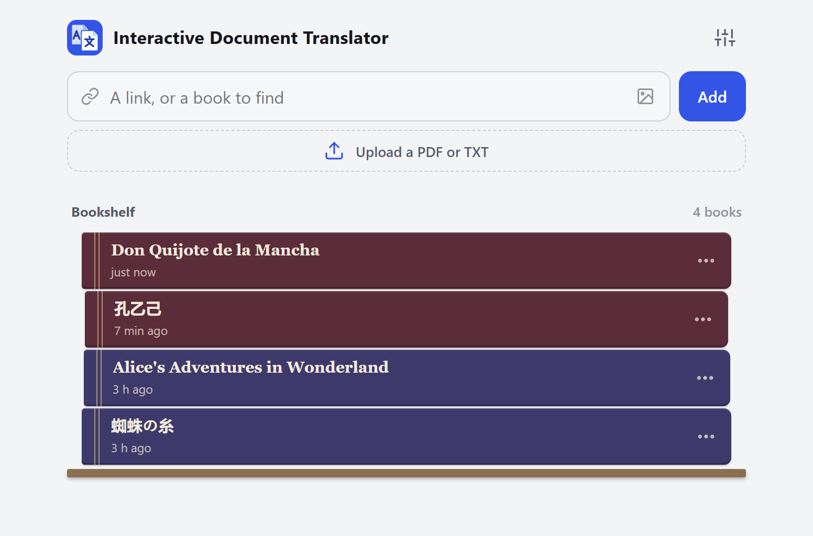
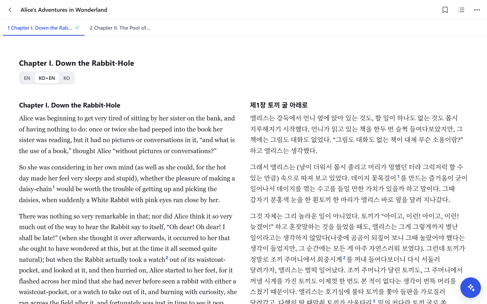
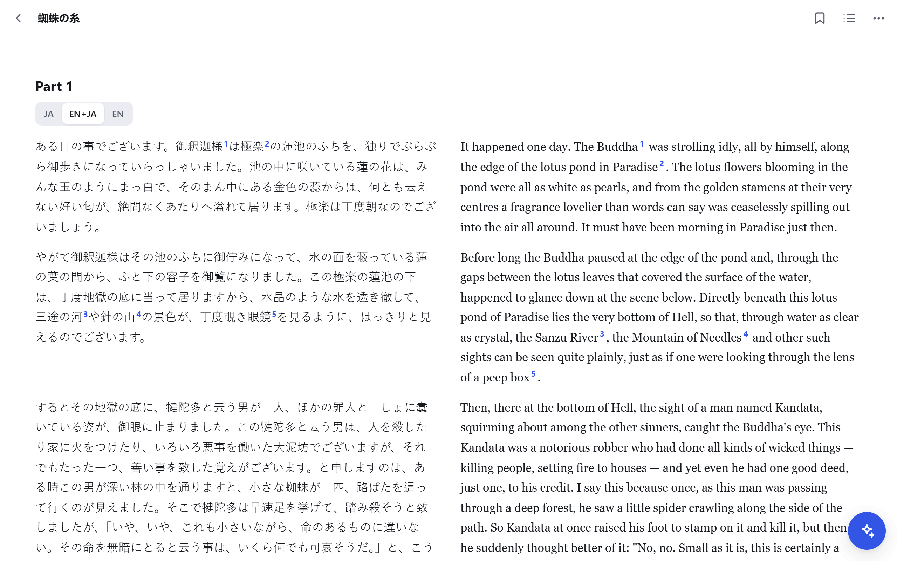
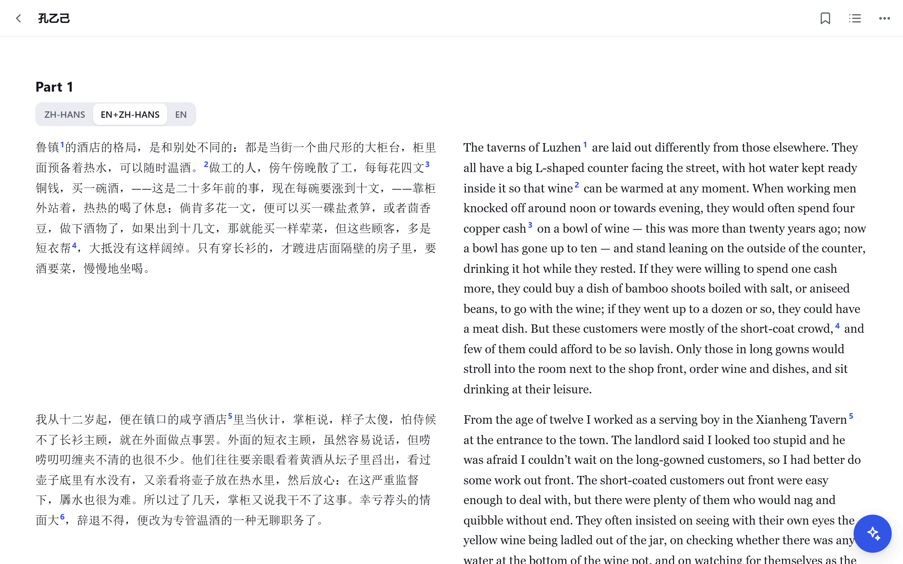
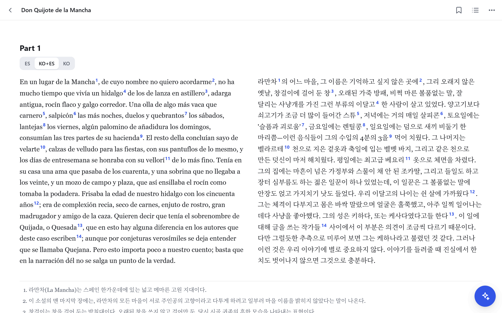
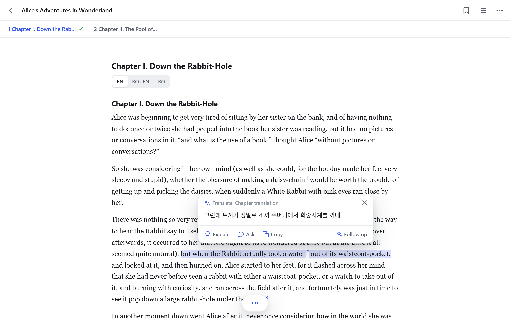
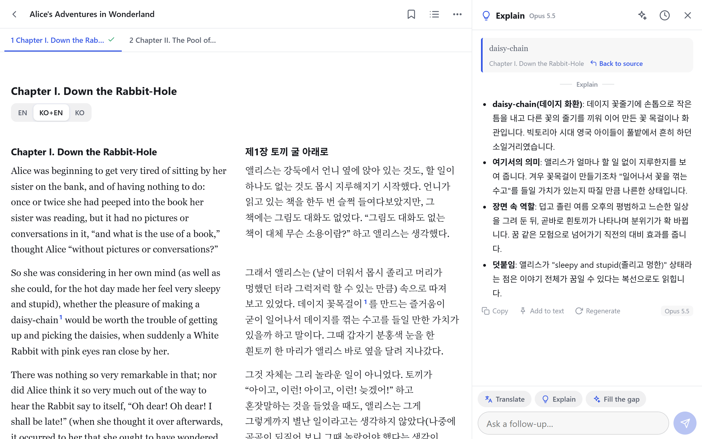
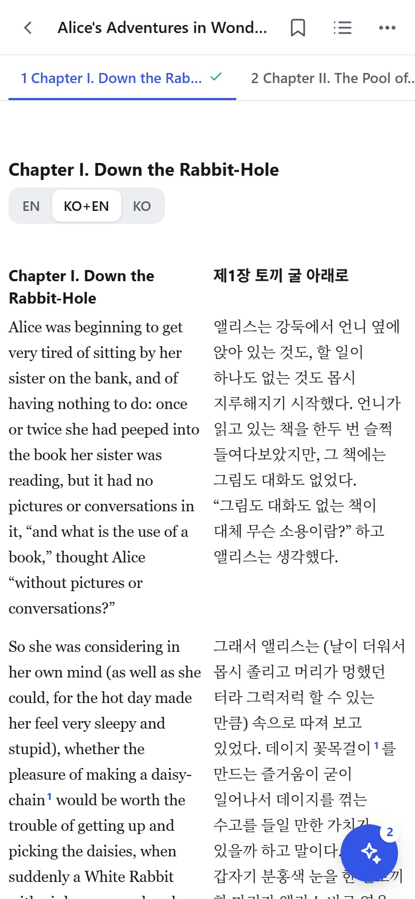

<h1 align="center">Interactive Document Translator</h1>

<p align="center">Lee un libro, una página web o un artículo en un idioma con ayuda en otro: traducción lado a lado, cada cláusula que tocas mostrada en el otro idioma y cualquier palabra o pasaje explicado en su contexto. Autoalojado.</p>

<p align="center"><a href="README.md">English</a> · Español · <a href="README.zh-CN.md">简体中文 (PaperGloss, the upstream project)</a></p>



Interactive Document Translator es un fork de **[PaperGloss](https://github.com/shenyizg/papergloss)**, de shenyizg (MIT), una aplicación web para leer artículos científicos en el móvil con un LLM a mano. Todo lo que hace PaperGloss sigue aquí ([Modo artículo](#modo-artículo-de-papergloss)); este fork añade el **modo libro**: leer un libro escrito en un idioma (el idioma *de origen*) con ayuda en el tuyo (el idioma *de destino*). Inglés → coreano es el par predeterminado y aquel para el que se escribieron y ajustaron las instrucciones (prompts); se puede elegir cualquier otro par de idiomas.

## Ejemplos

Cada uno es un texto breve de dominio público, importado como archivo `.txt`, con sus dos idiomas fijados en el menú ⋯ del libro (**Languages**) y traducido con el botón **Translate** del capítulo, y luego leído lado a lado.

### Inglés → coreano



*Alice's Adventures in Wonderland* (*Alicia en el país de las maravillas*), Lewis Carroll, 1865 (dominio público): el comienzo del capítulo I junto a su traducción al coreano (`KO+EN`), con marcas de nota en ambos.

### Japonés → inglés



「蜘蛛の糸」 (*El hilo de la araña*), Akutagawa Ryūnosuke, 1918 (dominio público): el comienzo junto a su traducción al inglés (`EN+JA`), con las notas de la traducción marcadas en ambos.

### Chino → inglés



《孔乙己》 (*Kong Yiji*), Lu Xun, 1919 (dominio público): los párrafos iniciales junto a su traducción al inglés (`EN+ZH-HANS`), con las notas de la traducción marcadas en ambos.

### Español → coreano



*Don Quijote de la Mancha*, Miguel de Cervantes, 1605 (dominio público): el primer párrafo de la primera parte, capítulo I, junto a su traducción al coreano (`KO+ES`), con las notas de la traducción marcadas en ambos.

## Modo libro

- **Trae un libro.** Sube un PDF (los libros escaneados pasan por OCR página a página) o un archivo `.txt` en UTF-8, importa una página web que no tenga PDF (por ejemplo, un capítulo de CCEL) y deja que siga los enlaces "next", o describe un libro (o fotografía su cubierta) y deja que Claude busque en la web una copia gratuita y legal. Cada uno se convierte en un libro de capítulos que se abre en modo HTML y se lee capítulo a capítulo desde las pestañas que hay bajo la barra de herramientas.
- **Pregunta por cualquier palabra, frase o párrafo.** Selecciónalo: Claude responde en tu idioma después de leer una ficha del libro, un resumen de cada capítulo y el capítulo actual completo (la ficha y los resúmenes se escriben una sola vez, en segundo plano, con Claude Haiku). Con el modelo en `auto`, una llamada rápida a Haiku elige Haiku, Sonnet u Opus para cada petición. Una primera pregunta idéntica en el mismo capítulo se contesta con la respuesta guardada.
- **Traduce un capítulo** al idioma de destino con Claude Opus al máximo esfuerzo y después una pasada de revisión, con notas al pie sobre costumbres, historia, Escritura y refranes que un alumno de secundaria del idioma de destino quizá no conozca. Un toque lo pone en marcha; el botón muestra el coste y el tiempo estimados, y mientras dura, la barra muestra el tiempo restante, el coste hasta el momento y **Stop** (un capítulo detenido se reanuda desde lo ya hecho). Las llamadas fallidas se reintentan; se traducen hasta tres capítulos a la vez; un capítulo estimado en más de 5 USD se traduce en partes de 5 USD como máximo. Las notas al pie también se marcan en el original, tras las palabras que explican.
- **Lee de tres maneras:** solo el original, lado a lado o solo la traducción (el selector lleva los códigos de idioma: `EN` · `KO+EN` · `KO` para un libro en inglés leído en coreano). Lado a lado también funciona en el móvil, con letra más pequeña.
- **Toca una cláusula** (hasta una coma o un punto y coma) en un capítulo traducido: las palabras de la traducción que la expresan se marcan al instante (lado a lado) o aparecen en un globo, sin llamar al modelo; Claude Haiku empareja las cláusulas con su traducción una vez por capítulo, y hasta entonces el navegador las empareja por longitud. Toca otra vez para ver la frase entera. En un capítulo aún sin traducir, el toque le pide al modelo esa cláusula con su frase a la vista (Settings permite desactivarlo).
- **Márcalo.** Los resaltados, subrayados, marcadores y notas se guardan en el servidor y en el navegador; un resaltado en el original pasa también a su traducción, y la traducción se puede seleccionar, resaltar y consultar igual que el libro.
- **Los libros escaneados** reciben una ligera limpieza del texto del OCR con Claude Haiku antes de abrirse, y sus imágenes (grabados, láminas) se recortan y se muestran donde estaban.



Una cláusula tocada mientras se lee en `EN`: las palabras de la traducción al coreano que la expresan, en el globo (*Alice's Adventures in Wonderland*, Lewis Carroll, 1865; dominio público).



"daisy-chain" seleccionada y luego **Explain**: la respuesta, en coreano, en el panel de IA junto al texto (*Alice's Adventures in Wonderland*, Lewis Carroll, 1865; dominio público).



En un móvil, lado a lado con letra más pequeña (*Alice's Adventures in Wonderland*, Lewis Carroll, 1865; dominio público).

### Ejemplo: un libro en inglés, un lector coreano

Es lo predeterminado: no hay nada que configurar. Abre *Alice's Adventures in Wonderland* desde un PDF o un archivo `.txt`, selecciona "daisy-chain" y la respuesta llega en coreano, con el sentido que tiene la palabra en ese punto. Traduce el capítulo y su versión coreana llega con notas al pie para un alumno coreano de secundaria (costumbres, historia, Escritura y refranes que quizá no conozca; nombres y préstamos escritos según el 외래어 표기법); léelo en `EN`, `KO+EN` o `KO`.

### Elegir otros idiomas

Los idiomas son códigos BCP-47: `en`, `ko`, `ja`, `zh-Hans`, `zh-Hant`, `fr`, `de`, `es`, `pt-BR`, `la`, etc. El par de un libro sale, por orden de prioridad, de:

1. **El propio libro**: menú ⋯ del libro → **Languages**, por ejemplo `fr` → `ko` para un libro francés en una biblioteca de libros en inglés.
2. **Settings → Books**: *Books are written in* y *Translate books into*.
3. **El entorno**: `BOOK_SOURCE_LANG` y `BOOK_TARGET_LANG` (valores predeterminados para un servidor cuyos Settings no indiquen ninguno).
4. Inglés → coreano.

Un libro conserva el par con el que se tradujo por primera vez, así que cambiar Settings más tarde deja sus traducciones como están; a partir de ahí, su propio idioma todavía se puede corregir en su menú, pero no el idioma al que se traduce. Las respuestas también llegan en el idioma de destino (con su propio nombre, como "Español" o "日本語"), salvo que **Settings → Translate into / answer in** indique otro.

Las instrucciones nombran los dos idiomas ("You translate Japanese books into English for an English middle-school student…"); para inglés → coreano son, byte a byte, las mismas que antes de que existieran otros pares. Lo que una instrucción dice de un idioma de destino más allá de su nombre (la transcripción de préstamos del coreano, sus nombres protestantes de los libros de la Biblia, su espaciado entre palabras) está en una sola tabla (`TARGETS` en `server/langs.js`), donde se pueden añadir las convenciones de otro idioma. La división en frases y cláusulas conoce los puntos y las comas del chino y del japonés, y sabe que no ponen espacios entre palabras. [Ejemplos](#ejemplos) muestra otros tres pares.

Notas sinceras sobre otros pares: las instrucciones se escribieron primero para inglés → coreano; los demás pares usan las mismas instrucciones con los idiomas nombrados, y se han probado contra un stub en los tests y, con el modelo real, solo con los textos breves de [Ejemplos](#ejemplos). Los ejemplos de emparejamiento de cláusulas de la instrucción siguen siendo de inglés → coreano para todos los pares. Un libro escaneado que no está en inglés pasa por el OCR en su idioma cuando tesseract tiene instalados los datos de ese idioma (por ejemplo `tesseract-ocr-fra`, o las opciones de idioma del instalador de Windows), y como inglés en caso contrario, con un aviso en el registro. Cuando los dos idiomas usan la misma escritura (inglés y español, por ejemplo), un capítulo que ya está en el idioma de destino no se distingue de uno que hay que traducir.

### Cuánto cuesta

La traducción es la parte cara. Con Claude Opus al máximo esfuerzo (más la revisión), un capítulo de inglés a coreano cuesta unos **0,55–0,6 USD por cada 1000 caracteres** del original, casi todo en razonamiento; la estimación del botón usa 0,65 USD para pecar por exceso, y un capítulo estimado en más de 5 USD se traduce en partes de 5 USD como máximo. Otros idiomas cuestan distinto por carácter (un carácter de chino o de japonés dice más que uno de inglés), y la estimación puede quedarse corta: de los [Ejemplos](#ejemplos), el comienzo en chino (638 caracteres) costó 0,96 USD y el párrafo en español de 1605 (1204 caracteres), 1,85 USD: cada uno, más del doble de su estimación. Con `TRANSLATE_AUTO=1`, la introducción y el capítulo 1 de cada libro se traducen solos; si no, solo gastan los botones. Las respuestas a las selecciones van a Haiku, Sonnet u Opus según elija el enrutador (o al modelo que fijes), con la ficha del libro, los resúmenes y el capítulo en caché; los resúmenes y la ficha se escriben una vez por libro con Haiku. Cada llamada al modelo queda registrada en `data/usage.jsonl`.

## Modo artículo (de PaperGloss)


- **Importa desde muchas fuentes.** Identificadores y enlaces de arXiv (también funcionan los de alphaXiv, Hugging Face Papers, ar5iv y papers.cool), ACL Anthology, DOI, enlaces directos a PDF y páginas de artículos que exponen `citation_pdf_url` (NeurIPS, PMLR y muchas editoriales). Subir un archivo crea un libro.
- **Dos modos de lectura.**
  - **HTML** (artículos de arXiv): la versión HTML del propio arXiv, adaptada al ancho de la pantalla, con fórmulas de verdad (MathML). El tamaño y el tipo de letra se pueden ajustar.
  - **PDF**: la maquetación original. Pellizca para ampliar; toca dos veces una columna para ajustarla al ancho y otras dos para volver; índice y salto a página.
- **Selecciona para traducir, explicar o preguntar.** Mantén pulsado cualquier texto y elige una acción. El párrafo que lo rodea va como contexto, las fórmulas de la versión HTML se envían como LaTeX y una sola palabra recibe una entrada de diccionario. Con **Translate on select** activado (en el menú ⋯), una ventana emergente va mostrando la traducción en cuanto seleccionas texto.
- **Captura de región** (modo PDF): arrastra un recuadro alrededor de una fórmula, una figura o una tabla y pregunta por ella a un modelo con visión.
- **Preguntas de seguimiento.** Cada selección se convierte en una pequeña conversación; "Back to source" vuelve al lugar de donde salió.
- **Pregunta por el artículo entero**, con el texto completo como contexto.
- **Vista previa de referencias.** Tocar una cita, una referencia a una figura o una nota abre una tarjeta de vista previa en lugar de saltar a otra parte.
- **Historial.** Las conversaciones se guardan por artículo en el servidor, así que te acompañan de un dispositivo a otro.
- **Usa tu propio modelo.** Anthropic (con el SDK oficial) o cualquier API compatible con OpenAI: OpenAI, DeepSeek, Gemini, Qwen, Kimi, GLM, SiliconFlow, OpenRouter, Ollama o un relay. Se pueden guardar claves de varios proveedores a la vez; si uno falla, cambia a otro desde el lector o directamente desde el mensaje de error. Los resúmenes, las traducciones, las notas al pie y el emparejamiento de cláusulas del modo libro necesitan Anthropic.
- Índice que se puede fijar junto al texto en pantallas anchas, una barra de herramientas que puede quedarse visible, interfaz en inglés y en chino, modo oscuro, posición de lectura guardada, instalable en la pantalla de inicio.


Las capturas de esta sección son de PaperGloss y muestran el modo artículo.

## Inicio rápido

Requiere Node.js 20 o posterior; los libros en PDF necesitan además poppler (`pdftotext`, `pdftoppm`) y tesseract en el PATH (`brew install poppler tesseract`, `sudo apt install poppler-utils tesseract-ocr` o, en Windows, `winget install UB-Mannheim.TesseractOCR` y `winget install oschwartz10612.Poppler`).

```bash
git clone <this repository> interactive-document-translator
cd interactive-document-translator
npm ci
npm start
```

Abre <http://localhost:8787>. En el primer arranque, el servidor imprime una contraseña de acceso generada; solo se guarda un hash de ella, así que apúntala (consulta [¿Olvidaste la contraseña?](#olvidaste-la-contraseña)). Inicia sesión, abre **Settings**, elige un proveedor, pega tu clave de API, elige un modelo y pulsa **Test connection**. Para leer, por ejemplo, libros japoneses en inglés, pon también **Settings → Books** en `ja` y `en` (o arranca con `BOOK_SOURCE_LANG=ja BOOK_TARGET_LANG=en npm start`).

## Configuración

| Variable | Para qué sirve | Valor predeterminado |
|---|---|---|
| `PORT` | Puerto en el que escucha | `8787` |
| `HOST` | Dirección en la que escucha; `0.0.0.0` abre el servidor a la red local | `127.0.0.1` |
| `DATA_DIR` | Dónde se guardan los libros, los artículos, los ajustes y el historial | `./data` |
| `PAPERGLOSS_PASSWORD` | Fija la contraseña de acceso desde el entorno (nunca se escribe en disco); al menos 12 caracteres, o el servidor no arranca | — |
| `BOOK_SOURCE_LANG` / `BOOK_TARGET_LANG` | El idioma en que están escritos los libros y aquel al que se traducen (códigos BCP-47), hasta que Settings o un libro indiquen otros | `en` / `ko` |
| `ANTHROPIC_API_KEY` | Clave de Anthropic que se usa cuando no hay ninguna guardada en Settings | — |
| `SUMMARY_MODEL` | Modelo para los resúmenes de capítulo y la ficha del libro | `claude-haiku-5-5` |
| `FIND_MODEL` | Modelo que busca un libro en la web | `claude-opus-5-5` |
| `TRANSLATE_AUTO=1` | Traduce automáticamente la introducción y el capítulo 1 de cada libro (de un capítulo en partes, solo la primera); sin esto, solo traducen los botones | — |
| `TRANSLATE_PARALLEL` | Cuántos capítulos se pueden traducir a la vez (la petición de uno más se rechaza). Más a la vez cuesta lo mismo en total, solo que antes, y puede chocar con el límite de tokens de salida por minuto de Opus | `3` |
| `HTTPS_PROXY` / `HTTP_PROXY` / `NO_PROXY` | Proxy para las peticiones salientes (arXiv, APIs de modelos), con las mismas reglas que curl; a `localhost` siempre se llega directamente | — |
| `PAPERGLOSS_NO_PROXY=1` | Ignora las variables de proxy anteriores | — |
| `PAPERGLOSS_TRUST_PROXY=1` | Confía en las cabeceras `X-Forwarded-*` de cualquier equipo, para un proxy inverso en otra máquina o en otro contenedor (por defecto solo se confía en un proxy de la misma máquina) | — |
| `PAPERGLOSS_ALLOW_PRIVATE_URLS=1` | Permite importar desde esta máquina o desde la red local (bloqueado por defecto) | — |
| `LOG_FILE` | El registro del servidor: todo lo que imprime, incluida cada llamada fallida al modelo y sus reintentos. Se limita a unos 2 MB más el anterior (`server.log.1`); `off` lo desactiva. El de otra app (`APP_ID`) lleva su id en el nombre: `server-<id>.log` | `~/.config/interactive-document-translator/server.log` |
| `BACKUP_DIR` | Copias de seguridad automáticas: al arrancar y cada hora, si algo ha cambiado, una copia de cada archivo `.json`/`.jsonl` de la carpeta de datos (resaltados, hilos de IA, traducciones, metadatos, uso) en `auto/<YYYYMMDD-HHMMSS>/`; se conservan las 48 más recientes y la más reciente de cada día durante 30 días. Los PDF, las páginas, las imágenes y `config.json` quedan fuera. `off` las desactiva | `~/interactive-document-translator-backups` |
| `FORCE_START=1` | Arranca aunque el latido de otro servidor en `data/server.lock` sea reciente | — |
| `APP_ID` / `APP_NAME` | Otra app del mismo código (consulta [Varias apps desde una copia](#varias-apps-desde-una-copia)) | — / `Interactive Document Translator` |

Todo lo demás (proveedor, modelo, idiomas, idioma de las respuestas, instrucciones, idioma de la interfaz) se configura en la app.

### ¿Olvidaste la contraseña?

Detén el servidor, borra la línea `passwordHash` de `data/config.json` y vuelve a arrancarlo: se imprime una contraseña nueva. También puedes fijar `PAPERGLOSS_PASSWORD`.

## Modelos

- **Anthropic** funciona con el SDK oficial de TypeScript. El modelo predeterminado es `auto`: antes de cada turno en un libro, una breve llamada a Claude Haiku lee el título del libro y la petición (no el capítulo) y elige Haiku, Sonnet u Opus; si esa llamada falla, responde Sonnet. Una pregunta de seguimiento se queda con el modelo de la respuesta anterior, y las preguntas fuera de un libro (chats sobre un artículo entero) usan Opus. Las llamadas del enrutador se registran en `data/usage.jsonl` con `router: true`; **Test connection** comprueba Haiku. Cualquier otro id de modelo en Settings significa ese modelo siempre. La `ANTHROPIC_API_KEY` del entorno solo se envía a la API oficial; una URL base personalizada necesita su propia clave en Settings. El esfuerzo de cada acción se puede cambiar en **Settings → Advanced**. En la API oficial, las peticiones rechazadas por un clasificador de seguridad se reintentan con el modelo de respaldo que recomienda Anthropic.
- **Las APIs compatibles con OpenAI** usan Chat Completions con streaming. La mayoría de las URL base terminan en `/v1`. **Fetch list** en Settings lee la lista de modelos del proveedor.
- La captura de región y las explicaciones de figuras necesitan un modelo que acepte imágenes.

El idioma de las respuestas es independiente del idioma de la interfaz (inglés o chino), así que puedes usar la interfaz en inglés y recibir las respuestas en coreano.

## Uso en el móvil y acceso remoto

- Si tu móvil y el servidor están en la misma red o VPN, arranca el servidor con `HOST=0.0.0.0` y abre `http://<server-ip>:8787`.
- Para llegar a él desde internet, deja `HOST=127.0.0.1` y pon delante algo que se ejecute en la misma máquina: un proxy inverso HTTPS (por ejemplo Caddy, más abajo), un Cloudflare Tunnel (`cloudflared tunnel --url http://localhost:8787`) o Tailscale (`tailscale serve --bg 8787` para tus propios dispositivos). Envían `X-Forwarded-Proto: https` y `X-Forwarded-For`, así que las sesiones reciben cookies Secure y el límite de inicios de sesión cuenta cada cliente por separado.

  ```
  reader.example.com {
      reverse_proxy 127.0.0.1:8787
  }
  ```

  Conserva la cabecera `Host` original (Caddy lo hace por defecto; Apache necesita `ProxyPreserveHost On`). Si el proxy se ejecuta en otra máquina o en otro contenedor, fija `PAPERGLOSS_TRUST_PROXY=1`. La contraseña se exige en cualquier caso; fija una `PAPERGLOSS_PASSWORD` larga.
- En Safari, **Compartir → Añadir a pantalla de inicio** la abre a pantalla completa, como una app.

## Ejecutarlo como servicio

Los **ajustes** pueden ir en `~/.config/interactive-document-translator/env` (en Windows, `$HOME\.config\interactive-document-translator\env`), fuera de la carpeta del proyecto:

```bash
ANTHROPIC_API_KEY=sk-ant-...
PAPERGLOSS_PASSWORD=choose-a-long-password
PORT=8787
HOST=127.0.0.1
BOOK_SOURCE_LANG=en
BOOK_TARGET_LANG=ko
```

`scripts/start.sh` (o `scripts\start.ps1` en Windows) cambia a la carpeta del proyecto, lee ese archivo y ejecuta el servidor; `start.ps1` además lo vuelve a arrancar un minuto después de que se detenga. Un segundo servidor no puede arrancar sobre la misma carpeta de datos mientras el primero siga vivo: el servidor en marcha actualiza `data/server.lock` cada minuto, y otro se niega a arrancar mientras ese latido tenga menos de 3 minutos (o, en la misma máquina, mientras siga en marcha el proceso que lo escribió). Si una máquina se colgó y no puedes esperar, arranca con `FORCE_START=1`.

**Arranque automático.** Los archivos de unidad son el único lugar con una ruta absoluta. Vuelve a ejecutar el comando desde la carpeta del proyecto cada vez que la carpeta se mueva.

- macOS (launchd; `caffeinate -i` en la plantilla evita que el Mac entre en reposo por inactividad mientras se ejecuta el servidor; los registros van a `~/Library/Logs/interactive-document-translator.log`):

  ```bash
  sed -e "s|@ROOT@|$PWD|g" -e "s|@HOME@|$HOME|g" scripts/interactive-document-translator.plist > ~/Library/LaunchAgents/org.interactive-document-translator.plist && launchctl bootout gui/$(id -u)/org.interactive-document-translator 2>/dev/null; launchctl bootstrap gui/$(id -u) ~/Library/LaunchAgents/org.interactive-document-translator.plist
  ```

- Linux (unidad de usuario de systemd; registros con `journalctl --user -u interactive-document-translator`):

  ```bash
  mkdir -p ~/.config/systemd/user && sed "s|@ROOT@|$PWD|g" scripts/interactive-document-translator.service > ~/.config/systemd/user/interactive-document-translator.service && systemctl --user daemon-reload && systemctl --user enable --now interactive-document-translator && loginctl enable-linger $USER
  ```

- Windows: `powershell -ExecutionPolicy Bypass -File scripts\autostart.ps1` registra una tarea del Programador de tareas, `interactive-document-translator`, que ejecuta `start.ps1` sin ventana cada vez que inicias sesión. `Stop-ScheduledTask interactive-document-translator` la detiene. Vuelve a ejecutar el script después de mover la carpeta.

Para que un ordenador de escritorio siga sirviendo, desactiva la suspensión mientras esté enchufado.

## Varias apps desde una copia

El mismo código puede ejecutarse como varias apps, cada una con su propio nombre, cookie de sesión, puerto, carpeta de datos, copias de seguridad y registro. La predeterminada es Interactive Document Translator (`data/`). Otra es un archivo `instances/<name>.env` con `APP_ID`, `APP_NAME`, `PORT` y `DATA_DIR` (sin secretos: esos se quedan en el archivo env de arriba), por ejemplo `instances/work.env`:

```bash
APP_NAME="Document Translator (work)"
PORT=8788
DATA_DIR=data-work
```

Arráncala con `scripts/start.sh work` (`scripts\start.ps1 work`), o haz que arranque al iniciar sesión con `scripts\autostart.ps1 work`. Su id es su nombre salvo que el archivo indique otro, y los scripts de arranque rechazan un archivo sin un `DATA_DIR` propio. Una app busca sus iconos como `public/icons/<id>.svg` (y `-192.png`, `-512.png`, `-touch.png`); sin ellos, usa los predeterminados (`public/icons/app.svg`, etc.). `scripts/logos.py` dibuja los dos juegos, el predeterminado en azul y `work` en naranja; añade ahí un color para otra app. En la pantalla de inicio de un móvil, la app predeterminada se llama "Doc Translator", y cualquier otra, según su `APP_NAME`. Dos apps pueden servir desde una sola copia a lectores de idiomas distintos: dale a cada una su propio `BOOK_SOURCE_LANG` / `BOOK_TARGET_LANG`.

## Privacidad y seguridad

- Todo se queda en tu servidor, bajo `data/`: libros, PDF, HTML en caché, ajustes y conversaciones.
- El proveedor del modelo recibe solo lo que necesita cada petición: el texto seleccionado con su párrafo, y el título y el resumen del artículo; el texto completo cuando preguntas por el artículo entero; la imagen cuando capturas una región. En un libro, cada pregunta lleva además la ficha del libro, los resúmenes de los capítulos y el capítulo actual completo, y cada capítulo se envía una vez para resumirlo. Los capítulos de un libro escaneado también se envían una vez para la limpieza del OCR, y un capítulo que traduces se envía con la ficha y los resúmenes del libro; después, sus párrafos con notas al pie se envían una vez más, con su traducción y las notas, para colocar las notas en el original, y un capítulo traducido, al abrirse, envía una vez más su original, cortado en cláusulas, con su traducción, para emparejar los dos. Una búsqueda de libro envía lo que escribiste o la foto que hiciste.
- Las claves de API se guardan en `data/config.json` (modo de archivo 600), una por proveedor. El navegador solo ve una vista previa enmascarada, y el servidor solo envía cada clave a la dirección para la que se guardó: apuntar un proveedor a otro servidor descarta su clave.
- El acceso está protegido por una contraseña, guardada como hash scrypt, y una cookie de sesión HttpOnly. Las sesiones duran 180 días y se renuevan mientras usas la app; cambiar la contraseña cierra la sesión en todos los dispositivos. Los intentos de inicio de sesión se limitan a 10 por dirección cada 10 minutos.
- Las peticiones desde otros sitios, incluidos otros subdominios de tu dominio, no pueden cambiar nada.
- Los enlaces no pueden llegar a esta máquina ni a tu red local (como `127.0.0.1`, `192.168.x.x` o las direcciones de metadatos de la nube), tampoco mediante redirecciones, salvo que se fije `PAPERGLOSS_ALLOW_PRIVATE_URLS=1`.
- Usa HTTPS siempre que el servidor sea accesible más allá de tu propia red.

## Organización de los datos

```
data/
  config.json            access password hash, AI settings (including the API key), languages
  server.lock            heartbeat of the server using this folder ({ host, pid, loop, at })
  usage.jsonl            one line per model call (ms: how long it took); a failed try has attempt and error
  papers/<id>/
    meta.json            title, authors, abstract, reading position (books: import status, languages)
    paper.pdf
    paper.html           cached arXiv HTML, or a book's chapters
    assets/              cached HTML images
    threads/<tid>.json   AI conversations
    book.json            books: chapter text, chapter summaries, brief
    source.txt           books uploaded as text
    annotations.json     books: highlights, underlines, bookmarks, notes
    lookups.jsonl        books: stored replies to first questions
    raw.json             scanned books: the text as OCR read it, for chapters the clean-up changed
    figures/p<n>-<k>.png scanned books: the pictures on page n (book.json `figures` places them)
    translations/<c>.json          books: a chapter's translation and its footnotes
    translations/<c>.p<k>.json     books: part k of a chapter translated in parts (its ranges are in meta.json)
    translations/<c>.notes-src.json  books: where those footnotes go in the original
    translations/<c>.clauses.json  books: which words of the translation say each clause of the original
```

Borrar un artículo o un libro elimina toda su carpeta. Fuera de la carpeta de datos: el registro del servidor y las copias de seguridad automáticas (consulta `LOG_FILE` y `BACKUP_DIR`). Para recuperar un archivo, cópialo de una instantánea a `data/` con el servidor detenido.

## Limitaciones conocidas

- OpenReview y algunas editoriales ponen las descargas automáticas detrás de una verificación humana: descárgalas en un navegador y súbelas.
- Los PDF escaneados no tienen capa de texto en modo PDF; súbelos como libros y lee el texto del OCR en modo HTML. El OCR pierde las letras capitulares decoradas ("T is of no more use" por "IT is…") y convierte las ilustraciones en una o dos líneas de ruido. Las imágenes se encuentran con el análisis de maquetación de página de tesseract, que se salta algunas.
- Los capítulos de un PDF se detectan por los encabezados en mayúsculas en lo alto de las páginas (o, más tarde, por sus marcadores, con `scripts/rechapter.mjs`); un libro en una escritura sin mayúsculas se corta en bloques de 10 páginas. Los encabezados de capítulo de un archivo de texto se detectan en varios idiomas ("Chapter", "Chapitre", "Kapitel", "第一章", "제1장" y otros).
- Los libros se limitan a PDF de hasta 3000 páginas y a páginas web de hasta 8 MB, y leer el texto de un libro puede llevar como máximo 20 segundos.
- Las traducciones avanzan de 4000 en 4000 caracteres, y un párrafo de más de 3000 caracteres, a trozos (cortado entre frases y luego unido), porque al máximo esfuerzo Opus razona unos 13–19 tokens por carácter de un original en inglés.
- Las preguntas sobre el artículo entero usan el texto extraído del PDF, donde las fórmulas y las tablas pueden salir desordenadas. La versión HTML de arXiv da un texto más limpio.

## Estructura del proyecto

```
server/            Node.js backend (no framework)
  index.js         routes and startup
  config.js        settings, the password, a book's languages (bookLangs)
  langs.js         what the prompts say of a pair of languages
  sources.js       input parsing, PDF downloads, arXiv metadata and HTML
  papers.js        library, HTML cache, conversations
  book.js          books: PDF/OCR, text and web imports, paper.html
  parse.js         text to chapters (run in a worker thread by parse-worker.js)
  context.js       the system prompt of book threads
  summary.js       chapter summaries and the book brief
  translate.js     chapter translation and review, OCR clean-up
  footnotes.js     where a translation's footnotes go in the original
  clauses.js       which words of a translation say each clause
  find.js          finding a book on the web
  lookups.js       stored replies, usage log
  annotations.js   highlights, underlines, bookmarks
  llm/             anthropic.js (official SDK), openai.js (OpenAI-compatible), router.js (model "auto")
  i18n.js          server messages in English and Chinese
  net.js           proxy-aware fetch
public/            frontend: plain ES modules, no build step
  assets/js/       reader.js, htmlview.js, translation.js, taps.js, sentences.js, langs.js, ai.js, …
scripts/           start.sh, start.ps1, autostart.ps1, launchd and systemd templates; rechapter.mjs, merge-chapters.mjs (book upkeep)
test/              tests (node:test), against an Anthropic stub: no real API calls
docs/DESIGN.md     how book mode works
```

No hay paso de compilación: edita los archivos de `public/` y recarga la página; reinicia el servidor después de cambiar `server/`. `npm test` ejecuta los tests.

## Licencia y créditos

[MIT](LICENSE). El código de terceros incluido aparece en [THIRD_PARTY_NOTICES.md](THIRD_PARTY_NOTICES.md).

Interactive Document Translator se basa en [PaperGloss](https://github.com/shenyizg/papergloss), de shenyizg; sus tres primeros commits en este repositorio son los de PaperGloss, sin cambios. Las capturas de PaperGloss muestran *Mixtral of Experts* (Jiang et al., [arXiv:2401.04088](https://arxiv.org/abs/2401.04088), CC BY 4.0), con respuestas de un modelo de demostración. Los datos de prueba son textos de dominio público: *John Ploughman's Talk*, de Spurgeon (edición de 1896, OCR de un escaneo de Google Books), y el *Commentary* de Matthew Henry (de CCEL).
