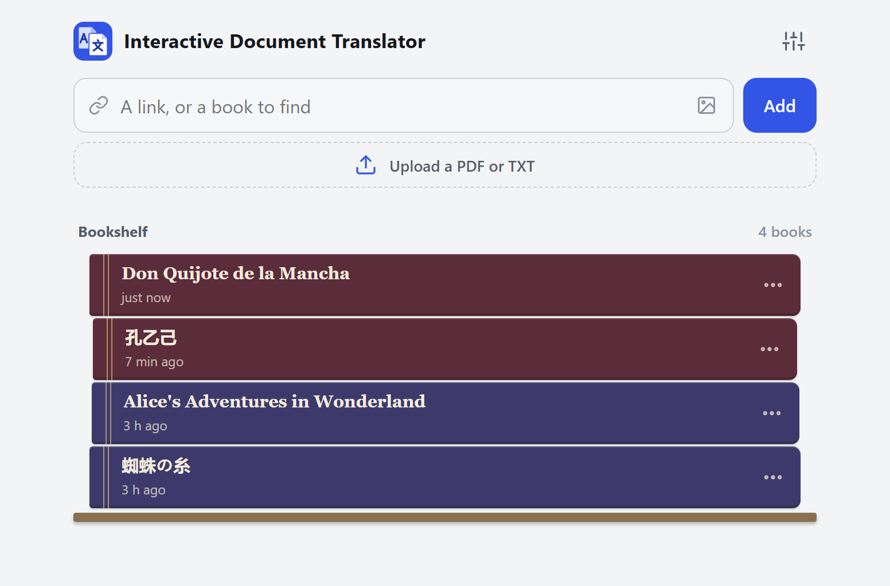
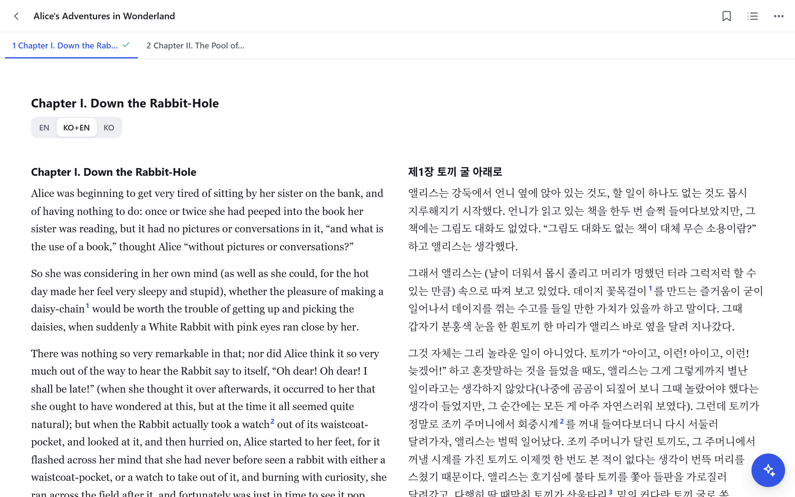
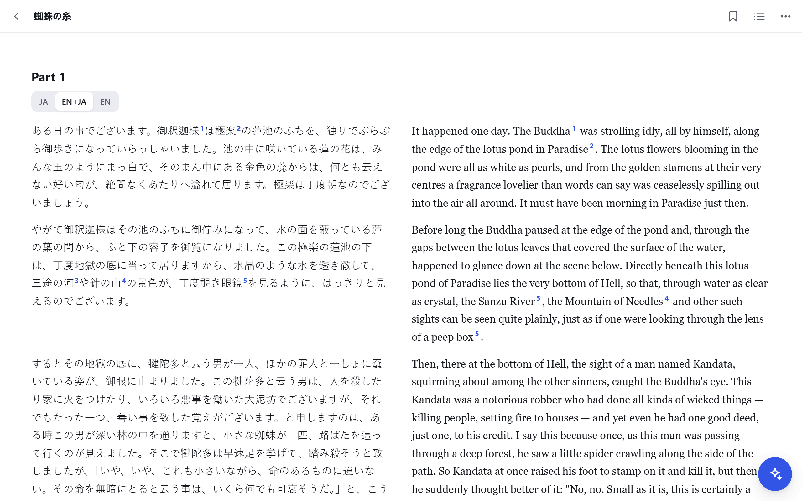
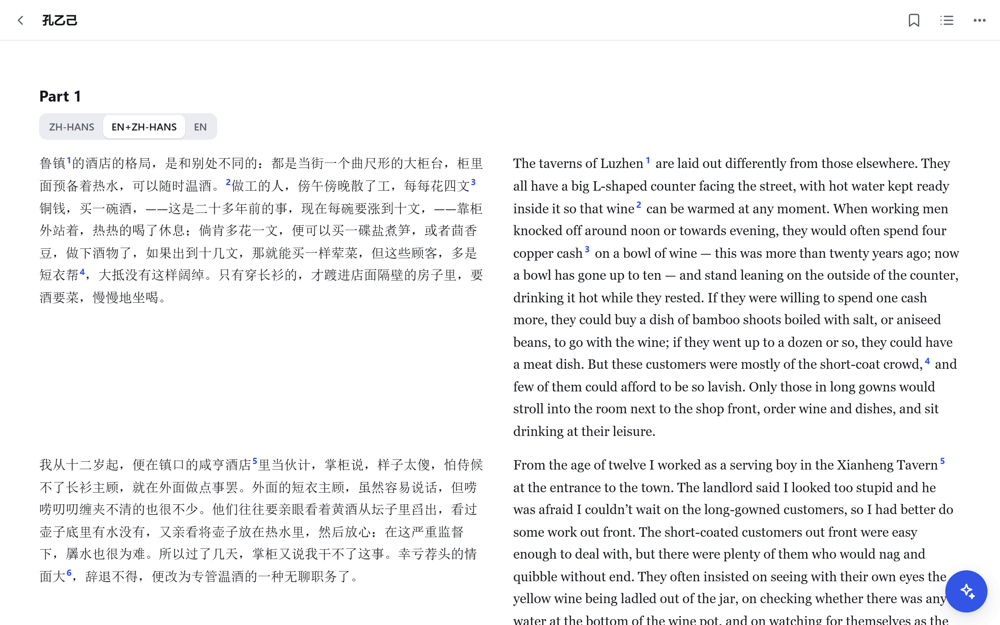
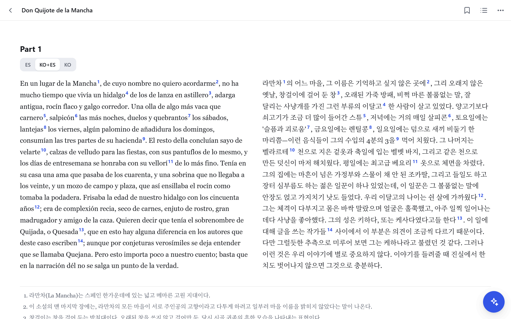
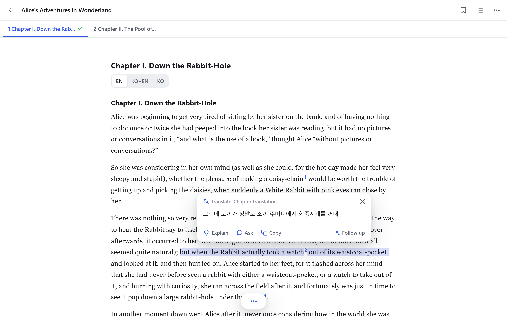
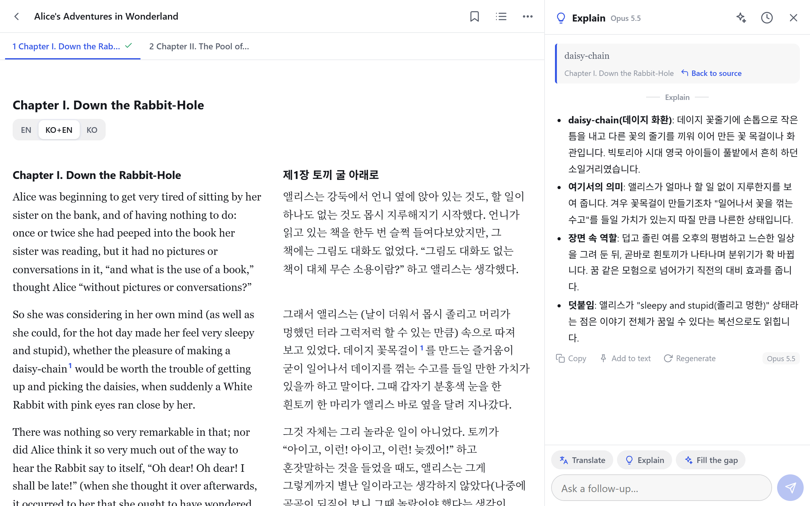
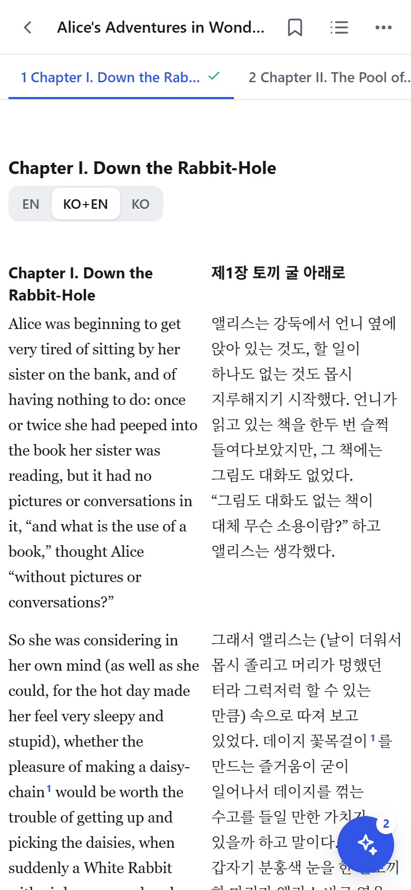

<h1 align="center">Interactive Document Translator</h1>

<p align="center">Read a book, a web page or a paper in one language with help in another: side-by-side translation, a tapped clause shown in the other language, and any word or passage explained in context. Self-hosted.</p>

<p align="center">English · <a href="README.es.md">Español</a> · <a href="README.zh-CN.md">简体中文 (PaperGloss, the upstream project)</a></p>



Interactive Document Translator is a fork of **[PaperGloss](https://github.com/shenyizg/papergloss)** by shenyizg (MIT), a web app for reading research papers on a phone with an LLM at hand. Everything PaperGloss does is still here ([Paper mode](#paper-mode-from-papergloss)); this fork adds **book mode**: read a book written in one language (the *source* language) with help in yours (the *target* language). English → Korean is the default and the pair the prompts were written and tuned for; any other pair of languages can be chosen.

## Examples

Each of these is a short public-domain text, imported as a `.txt` file, given its two languages in the book's ⋯ menu (**Languages**) and translated with the chapter's **Translate** button, then read side by side.

### English → Korean



*Alice's Adventures in Wonderland*, Lewis Carroll, 1865 (public domain): the opening of chapter I beside its Korean translation (`KO+EN`), footnote markers in both.

### Japanese → English



「蜘蛛の糸」 (*The Spider's Thread*), Akutagawa Ryūnosuke, 1918 (public domain): the opening beside its English translation (`EN+JA`), the translation's footnotes marked in both.

### Chinese → English



《孔乙己》 (*Kong Yiji*), Lu Xun, 1919 (public domain): the opening paragraphs beside their English translation (`EN+ZH-HANS`), the translation's footnotes marked in both.

### Spanish → Korean



*Don Quijote de la Mancha*, Miguel de Cervantes, 1605 (public domain): the first paragraph of Part I, chapter I, beside its Korean translation (`KO+ES`), the translation's footnotes marked in both.

## Book mode

- **Bring a book.** Upload a PDF (scanned books are OCR'd page by page) or a UTF-8 `.txt` file, import a web page that has no PDF (for example a CCEL chapter) and let it follow the "next" links, or describe a book (or photograph its cover) and let Claude search the web for a free, legal copy. Each becomes a book of chapters that opens in HTML mode, read one chapter at a time from tabs under the toolbar.
- **Ask about any word, sentence or paragraph.** Select it: Claude answers in your language having read a brief of the book, a summary of every chapter and the whole current chapter (the brief and summaries are written once, in the background, with Claude Haiku). With the model set to `auto`, a quick Haiku call picks Haiku, Sonnet or Opus for each request. An identical first question in the same chapter is answered from the stored reply.
- **Translate a chapter** into the target language with Claude Opus at max effort, then a review pass, with footnotes on customs, history, Scripture and proverbs that a middle-school reader of the target language may not know. One tap starts it; the button shows the estimated cost and time, and while it runs the bar shows the time left, the cost so far and **Stop** (a stopped chapter resumes from what is done). Failed calls are retried; up to three chapters translate at once; a chapter estimated over $5 is translated in parts of at most $5. The footnotes are also marked in the original, after the words they explain.
- **Read three ways:** the original only, side by side, or the translation only (the switch is labelled with the language codes: `EN` · `KO+EN` · `KO` for an English book read in Korean). Side by side works on phones too, in smaller type.
- **Tap a clause** (up to a comma or semicolon) in a translated chapter: the words of the translation that say it are marked at once (side by side) or shown in a balloon, without a model call — Claude Haiku pairs clauses with their translation once per chapter; until then the browser pairs them by length. Tap again for the whole sentence. In a chapter not translated yet, the tap asks the model for that clause with its sentence in view (Settings can turn this off).
- **Mark it up.** Highlights, underlines, bookmarks and notes are kept on the server and in the browser; a highlight on the original goes on its translation too, and the translation can be selected, highlighted and asked about like the book.
- **Scanned books** get a light clean-up of the OCR text with Claude Haiku before they open, and their pictures (woodcuts, plates) are cut out and shown where they stood.



A clause tapped while reading `EN`: the words of the Korean translation that say it, in the balloon (*Alice's Adventures in Wonderland*, Lewis Carroll, 1865; public domain).



"daisy-chain" selected, then **Explain**: the answer, in Korean, in the AI panel beside the text (*Alice's Adventures in Wonderland*, Lewis Carroll, 1865; public domain).



On a phone, side by side in smaller type (*Alice's Adventures in Wonderland*, Lewis Carroll, 1865; public domain).

### Example: an English book, a Korean reader

This is the default: nothing to set. Open *Alice's Adventures in Wonderland* from a PDF or a `.txt` file, select "daisy-chain", and the answer comes in Korean with the word's sense at that spot. Translate the chapter, and its Korean comes with footnotes for a Korean middle-school reader (customs, history, Scripture and proverbs they may not know; names and loanwords spelled by 외래어 표기법); read it `EN`, `KO+EN` or `KO`.

### Choosing other languages

Languages are BCP-47 codes: `en`, `ko`, `ja`, `zh-Hans`, `zh-Hant`, `fr`, `de`, `es`, `pt-BR`, `la` and so on. A book's pair comes from, first to last:

1. **The book itself**: ⋯ menu in the book → **Languages**, for example `fr` → `ko` for a French book in a library of English ones.
2. **Settings → Books**: *Books are written in* and *Translate books into*.
3. **The environment**: `BOOK_SOURCE_LANG` and `BOOK_TARGET_LANG` (defaults for a server whose Settings name none).
4. English → Korean.

A book keeps the pair it was first translated with, so changing Settings later leaves its translations as they are; from then on its own language can still be corrected in its menu, but not the language it is translated into. Answers come in the target language too (its own name, such as "Español" or "日本語"), unless **Settings → Translate into / answer in** names another.

The prompts name the two languages ("You translate Japanese books into English for an English middle-school student…"); for English → Korean they are byte for byte what they were before other pairs existed. What a prompt says about a target language beyond its name — Korean's loanword spelling, its Protestant names for Bible books, its word spacing — lives in one table (`TARGETS` in `server/langs.js`), where another language's conventions can be added. Sentence and clause splitting know the full stops and commas of Chinese and Japanese and that they put no spaces between words. [Examples](#examples) shows three other pairs.

Honest notes on other pairs: the prompts were first written for English → Korean; other pairs use the same prompts with the languages named and have been exercised against a stub in the tests and, with the real model, only on the short texts in [Examples](#examples). The clause-pairing examples in the prompt stay English → Korean for every pair. A scanned book not in English is OCR'd in its language when tesseract has that language's data installed (for example `tesseract-ocr-fra`, or the Windows installer's language options), and as English otherwise, with a warning in the log. Where both languages are written in the same script (English and Spanish, say), a chapter already in the target language can't be told from one that needs translating.

### What it costs

Translation is the expensive part. With Claude Opus at max effort (plus the review), an English → Korean chapter costs about **$0.55–0.6 per 1,000 characters** of the original, nearly all of it thinking; the button's estimate uses $0.65 to err high, and a chapter estimated over $5 is translated in parts of at most $5 each. Other languages cost differently per character (a character of Chinese or Japanese says more than one of English), and the estimate can fall short: of the [Examples](#examples), the Chinese opening (638 characters) cost $0.96 and the Spanish paragraph from 1605 (1,204 characters) $1.85, each over twice its estimate. With `TRANSLATE_AUTO=1` each book's introduction and chapter 1 are translated by themselves; otherwise only the buttons spend. Answers to selections go to Haiku, Sonnet or Opus as the router picks (or the model you set), with the book's brief, summaries and chapter cached; summaries and the brief are written once per book with Haiku. Every model call is logged in `data/usage.jsonl`.

## Paper mode (from PaperGloss)


- **Import from many sources.** arXiv IDs and links (alphaXiv, Hugging Face Papers, ar5iv and papers.cool links work too), ACL Anthology, DOIs, direct PDF links, and paper pages that expose `citation_pdf_url` (NeurIPS, PMLR and many publishers). Uploading a file makes a book.
- **Two reading modes.**
  - **HTML** (arXiv papers): arXiv's own HTML rendering, reflowed to the screen width, with real math (MathML). Text size and font are adjustable.
  - **PDF**: the original layout. Pinch to zoom; double-tap a column to zoom to its width, double-tap again to reset; outline and page jump.
- **Select to translate, explain or ask.** Long-press any text and pick an action. The surrounding paragraph goes along as context, formulas from the HTML version are sent as LaTeX, and a single word gets a dictionary-style entry. With **Translate on select** turned on (in the ⋯ menu), a popup streams the translation as soon as you select text.
- **Region capture** (PDF mode): drag a box around a formula, figure or table and ask a vision-capable model about it.
- **Follow-up questions.** Every selection becomes a small conversation; "Back to source" jumps to where it came from.
- **Ask about the whole paper**, with the full text as context.
- **Reference previews.** Tapping a citation, figure reference or footnote opens a preview card instead of jumping away.
- **History.** Conversations are stored per paper on the server, so they follow you across devices.
- **Bring your own model.** Anthropic (through the official SDK) or any OpenAI-compatible API: OpenAI, DeepSeek, Gemini, Qwen, Kimi, GLM, SiliconFlow, OpenRouter, Ollama, or a relay. Keys for several providers can be saved at once; if one is down, switch to another from the reader or straight from the error message. Book mode's summaries, translations, footnotes and clause pairing need Anthropic.
- Contents that can be pinned beside the text on wider screens, a toolbar that can stay visible, English and Chinese interface, dark mode, reading position saved, installable to the home screen.


The screenshots in this section are PaperGloss's and show paper mode.

## Quick start

Requires Node.js 20 or later; PDF books also need poppler (`pdftotext`, `pdftoppm`) and tesseract on PATH (`brew install poppler tesseract`, `sudo apt install poppler-utils tesseract-ocr`, or on Windows `winget install UB-Mannheim.TesseractOCR` and `winget install oschwartz10612.Poppler`).

```bash
git clone <this repository> interactive-document-translator
cd interactive-document-translator
npm ci
npm start
```

Open <http://localhost:8787>. On first start the server prints a generated access password; only a hash of it is stored, so note it down (see [Forgot the password?](#forgot-the-password)). Sign in, open **Settings**, choose a provider, paste your API key, pick a model, and tap **Test connection**. To read, say, Japanese books in English, also set **Settings → Books** to `ja` and `en` (or start with `BOOK_SOURCE_LANG=ja BOOK_TARGET_LANG=en npm start`).

## Configuration

| Variable | Purpose | Default |
|---|---|---|
| `PORT` | Port to listen on | `8787` |
| `HOST` | Address to bind; `0.0.0.0` opens the server to the local network | `127.0.0.1` |
| `DATA_DIR` | Where books, papers, settings and history are stored | `./data` |
| `PAPERGLOSS_PASSWORD` | Set the access password from the environment (never written to disk); at least 12 characters, or the server won't start | — |
| `BOOK_SOURCE_LANG` / `BOOK_TARGET_LANG` | The language books are written in and the one they are translated into (BCP-47 codes), until Settings or a book name others | `en` / `ko` |
| `ANTHROPIC_API_KEY` | Anthropic key to use when none is saved in Settings | — |
| `SUMMARY_MODEL` | Model for chapter summaries and the book brief | `claude-haiku-5-5` |
| `FIND_MODEL` | Model that searches the web for a book | `claude-opus-5-5` |
| `TRANSLATE_AUTO=1` | Translate each book's introduction and chapter 1 automatically (of a chapter in parts, its first part only); without it only the buttons translate | — |
| `TRANSLATE_PARALLEL` | How many chapters may be translated at once (a request for one more is refused). More at once costs the same in total, only sooner, and can hit the Opus output-tokens-per-minute limit | `3` |
| `HTTPS_PROXY` / `HTTP_PROXY` / `NO_PROXY` | Proxy for outbound requests (arXiv, model APIs), with the same rules as curl; `localhost` is always reached directly | — |
| `PAPERGLOSS_NO_PROXY=1` | Ignore the proxy variables above | — |
| `PAPERGLOSS_TRUST_PROXY=1` | Trust `X-Forwarded-*` headers from any peer, for a reverse proxy on another machine or in another container (by default only a proxy on the same machine is trusted) | — |
| `PAPERGLOSS_ALLOW_PRIVATE_URLS=1` | Allow importing from this machine or the local network (blocked by default) | — |
| `LOG_FILE` | The server's log: everything it prints, including each failed model call and its retries. Kept to about 2 MB plus the one before it (`server.log.1`); `off` turns it off. Another app's (`APP_ID`) has its id in its name: `server-<id>.log` | `~/.config/interactive-document-translator/server.log` |
| `BACKUP_DIR` | Automatic backups: at startup and every hour, when something changed, a copy of every `.json`/`.jsonl` file in the data folder (highlights, AI threads, translations, metadata, usage) in `auto/<YYYYMMDD-HHMMSS>/`; the newest 48 are kept, and the newest of each day for 30 days. PDFs, pages, pictures and `config.json` are left out. `off` turns it off | `~/interactive-document-translator-backups` |
| `FORCE_START=1` | Start even though another server's heartbeat in `data/server.lock` is recent | — |
| `APP_ID` / `APP_NAME` | Another app of the same code (see [Several apps from one copy](#several-apps-from-one-copy)) | — / `Interactive Document Translator` |

Everything else (provider, model, languages, answer language, prompts, interface language) is set in the app.

### Forgot the password?

Stop the server, delete the `passwordHash` line from `data/config.json` and start it again: a new password is printed. Alternatively, set `PAPERGLOSS_PASSWORD`.

## Models

- **Anthropic** goes through the official TypeScript SDK. The default model is `auto`: before each turn in a book, a short Claude Haiku call reads the book's title and the request (not the chapter) and picks Haiku, Sonnet or Opus; if that call fails, Sonnet answers. A follow-up stays with the model of the answer before it, and questions outside a book (whole-paper chats) use Opus. The router's calls are logged in `data/usage.jsonl` with `router: true`; **Test connection** checks Haiku. Any other model id in Settings means that model every time. The `ANTHROPIC_API_KEY` from the environment is only sent to the official API; a custom base URL needs its own key in Settings. Effort per action can be changed under **Settings → Advanced**. On the official API, requests declined by a safety classifier are retried on Anthropic's recommended fallback model.
- **OpenAI-compatible APIs** use Chat Completions with streaming. Most base URLs end in `/v1`. **Fetch list** in Settings reads the provider's model list.
- Region capture and figure explanations need a model that accepts images.

The answer language is separate from the interface language (English or Chinese), so you can use an English interface and get answers in Korean.

## Using it on a phone, and remote access

- If your phone and the server are on the same network or VPN, start the server with `HOST=0.0.0.0` and open `http://<server-ip>:8787`.
- To reach it from the internet, keep `HOST=127.0.0.1` and put something in front that runs on the same machine: an HTTPS reverse proxy (for example Caddy, below), a Cloudflare Tunnel (`cloudflared tunnel --url http://localhost:8787`) or Tailscale (`tailscale serve --bg 8787` for your own devices). They send `X-Forwarded-Proto: https` and `X-Forwarded-For`, so sessions get Secure cookies and the sign-in limit counts each client.

  ```
  reader.example.com {
      reverse_proxy 127.0.0.1:8787
  }
  ```

  Keep the original `Host` header (Caddy does this by default, Apache needs `ProxyPreserveHost On`). If the proxy runs on another machine or in another container, set `PAPERGLOSS_TRUST_PROXY=1`. The password is required either way; set a long `PAPERGLOSS_PASSWORD`.
- In Safari, **Share → Add to Home Screen** opens it full screen like an app.

## Running as a service

**Settings** can go in `~/.config/interactive-document-translator/env` (on Windows, `$HOME\.config\interactive-document-translator\env`), outside the project folder:

```bash
ANTHROPIC_API_KEY=sk-ant-...
PAPERGLOSS_PASSWORD=choose-a-long-password
PORT=8787
HOST=127.0.0.1
BOOK_SOURCE_LANG=en
BOOK_TARGET_LANG=ko
```

`scripts/start.sh` (or `scripts\start.ps1` on Windows) changes to the project folder, reads that file and runs the server; `start.ps1` also starts it again a minute after it stops. A second server can't start on the same data folder while the first one is alive: the running server refreshes `data/server.lock` every minute, and another one refuses to start while that heartbeat is less than 3 minutes old (or, on the same machine, while the process that wrote it still runs). If a machine crashed and you can't wait, start with `FORCE_START=1`.

**Autostart.** The unit files are the only place with an absolute path. Run the command again from the project folder whenever the folder moves.

- macOS (launchd; `caffeinate -i` in the template keeps the Mac from idle-sleeping while the server runs; logs go to `~/Library/Logs/interactive-document-translator.log`):

  ```bash
  sed -e "s|@ROOT@|$PWD|g" -e "s|@HOME@|$HOME|g" scripts/interactive-document-translator.plist > ~/Library/LaunchAgents/org.interactive-document-translator.plist && launchctl bootout gui/$(id -u)/org.interactive-document-translator 2>/dev/null; launchctl bootstrap gui/$(id -u) ~/Library/LaunchAgents/org.interactive-document-translator.plist
  ```

- Linux (systemd user unit; logs with `journalctl --user -u interactive-document-translator`):

  ```bash
  mkdir -p ~/.config/systemd/user && sed "s|@ROOT@|$PWD|g" scripts/interactive-document-translator.service > ~/.config/systemd/user/interactive-document-translator.service && systemctl --user daemon-reload && systemctl --user enable --now interactive-document-translator && loginctl enable-linger $USER
  ```

- Windows: `powershell -ExecutionPolicy Bypass -File scripts\autostart.ps1` registers a Task Scheduler task, `interactive-document-translator`, that runs `start.ps1` without a window whenever you sign in. `Stop-ScheduledTask interactive-document-translator` stops it. Run the script again after the folder moves.

To keep a desktop serving, turn off sleep while it is plugged in.

## Several apps from one copy

The same code can run as several apps, each with its own name, sign-in cookie, port, data folder, backups and log. The default one is Interactive Document Translator (`data/`). Another is a file `instances/<name>.env` with `APP_ID`, `APP_NAME`, `PORT` and `DATA_DIR` (no secrets: those stay in the env file above), for example `instances/work.env`:

```bash
APP_NAME="Document Translator (work)"
PORT=8788
DATA_DIR=data-work
```

Start it with `scripts/start.sh work` (`scripts\start.ps1 work`), or have it start at sign-in with `scripts\autostart.ps1 work`. Its id is its name unless the file gives one, and the start scripts refuse a file without a `DATA_DIR` of its own. An app finds its icons as `public/icons/<id>.svg` (and `-192.png`, `-512.png`, `-touch.png`); without them it has the default ones (`public/icons/app.svg` and so on). `scripts/logos.py` draws both sets, the default in blue and `work` in orange; add a colour there for another app. On a phone's home screen the default app is called "Doc Translator", another app by its `APP_NAME`. Two apps can serve readers of different languages from one copy: give each its own `BOOK_SOURCE_LANG` / `BOOK_TARGET_LANG`.

## Privacy and security

- Everything stays on your server under `data/`: books, PDFs, cached HTML, settings and conversations.
- The model provider receives only what a request needs: the selected text with its surrounding paragraph and the paper's title and abstract; the full text when you ask about the whole paper; the image when you capture a region. In a book, every question also carries the book's brief, the chapter summaries and the whole current chapter, and each chapter is sent once to be summarized. A scanned book's chapters are also sent once for the OCR clean-up, and a chapter you translate is sent with the book's brief and summaries; afterwards its paragraphs that have footnotes go once more, with their translation and the notes, to place the notes in the original, and a translated chapter, when opened, sends its original, cut into clauses, once more with its translation, to pair the two. A book search sends what you typed or the photo you took.
- API keys are stored in `data/config.json` (file mode 600), one per provider. The browser only ever sees a masked preview, and the server only sends each key to the address it was saved for: pointing a provider at another server drops its key.
- Access is protected by a password, stored as an scrypt hash, and an HttpOnly session cookie. Sessions last 180 days and are renewed while you use the app; changing the password signs out every device. Sign-in attempts are limited to 10 per address per 10 minutes.
- Requests from other sites, including other subdomains of your domain, can't change anything.
- Links can't reach this machine or your local network (such as `127.0.0.1`, `192.168.x.x` or cloud metadata addresses), also not through redirects, unless `PAPERGLOSS_ALLOW_PRIVATE_URLS=1` is set.
- Use HTTPS whenever the server is reachable beyond your own network.

## Data layout

```
data/
  config.json            access password hash, AI settings (including the API key), languages
  server.lock            heartbeat of the server using this folder ({ host, pid, loop, at })
  usage.jsonl            one line per model call (ms: how long it took); a failed try has attempt and error
  papers/<id>/
    meta.json            title, authors, abstract, reading position (books: import status, languages)
    paper.pdf
    paper.html           cached arXiv HTML, or a book's chapters
    assets/              cached HTML images
    threads/<tid>.json   AI conversations
    book.json            books: chapter text, chapter summaries, brief
    source.txt           books uploaded as text
    annotations.json     books: highlights, underlines, bookmarks, notes
    lookups.jsonl        books: stored replies to first questions
    raw.json             scanned books: the text as OCR read it, for chapters the clean-up changed
    figures/p<n>-<k>.png scanned books: the pictures on page n (book.json `figures` places them)
    translations/<c>.json          books: a chapter's translation and its footnotes
    translations/<c>.p<k>.json     books: part k of a chapter translated in parts (its ranges are in meta.json)
    translations/<c>.notes-src.json  books: where those footnotes go in the original
    translations/<c>.clauses.json  books: which words of the translation say each clause of the original
```

Deleting a paper or book removes its whole folder. Outside the data folder: the server's log and the automatic backups (see `LOG_FILE` and `BACKUP_DIR`). To bring a file back, copy it from a snapshot into `data/` while the server is stopped.

## Known limitations

- OpenReview and some publishers put programmatic downloads behind a human-verification check: download those in a browser and upload them.
- Scanned PDFs have no text layer in PDF mode; upload them as books and read the OCR text in HTML mode. OCR loses decorated initial letters ("T is of no more use" for "IT is…") and turns illustrations into a line or two of noise. Pictures are found by tesseract's page layout analysis, which misses some.
- Chapters of a PDF are found from headings set in capitals at the top of pages (or, afterwards, from its bookmarks with `scripts/rechapter.mjs`); a book in a script without capitals is cut into 10-page chunks instead. A text file's chapter headings are found in several languages ("Chapter", "Chapitre", "Kapitel", "第一章", "제1장" and others).
- Books are limited to PDFs of up to 3000 pages and web pages of up to 8 MB, and reading a book's text may take at most 20 seconds.
- Translations go 4,000 characters at a time, and a paragraph over 3,000 characters a piece at a time (cut between sentences, then joined), because at max effort Opus thinks about 13–19 tokens per character of an English source.
- Whole-paper questions use text extracted from the PDF, where formulas and tables may be garbled. The arXiv HTML version gives cleaner text.

## Project layout

```
server/            Node.js backend (no framework)
  index.js         routes and startup
  config.js        settings, the password, a book's languages (bookLangs)
  langs.js         what the prompts say of a pair of languages
  sources.js       input parsing, PDF downloads, arXiv metadata and HTML
  papers.js        library, HTML cache, conversations
  book.js          books: PDF/OCR, text and web imports, paper.html
  parse.js         text to chapters (run in a worker thread by parse-worker.js)
  context.js       the system prompt of book threads
  summary.js       chapter summaries and the book brief
  translate.js     chapter translation and review, OCR clean-up
  footnotes.js     where a translation's footnotes go in the original
  clauses.js       which words of a translation say each clause
  find.js          finding a book on the web
  lookups.js       stored replies, usage log
  annotations.js   highlights, underlines, bookmarks
  llm/             anthropic.js (official SDK), openai.js (OpenAI-compatible), router.js (model "auto")
  i18n.js          server messages in English and Chinese
  net.js           proxy-aware fetch
public/            frontend: plain ES modules, no build step
  assets/js/       reader.js, htmlview.js, translation.js, taps.js, sentences.js, langs.js, ai.js, …
scripts/           start.sh, start.ps1, autostart.ps1, launchd and systemd templates; rechapter.mjs, merge-chapters.mjs (book upkeep)
test/              tests (node:test), against an Anthropic stub: no real API calls
docs/DESIGN.md     how book mode works
```

There is no build step: edit the files under `public/` and reload the page; restart the server after changing `server/`. `npm test` runs the tests.

## License and credits

[MIT](LICENSE). Bundled third-party code is listed in [THIRD_PARTY_NOTICES.md](THIRD_PARTY_NOTICES.md).

Interactive Document Translator is built on [PaperGloss](https://github.com/shenyizg/papergloss) by shenyizg; its first three commits in this repository are PaperGloss's, unchanged. The PaperGloss screenshots show *Mixtral of Experts* (Jiang et al., [arXiv:2401.04088](https://arxiv.org/abs/2401.04088), CC BY 4.0), with answers from a demo model. The test fixtures are public-domain texts: Spurgeon's *John Ploughman's Talk* (1896 edition, OCR of a Google Books scan) and Matthew Henry's *Commentary* (from CCEL).
